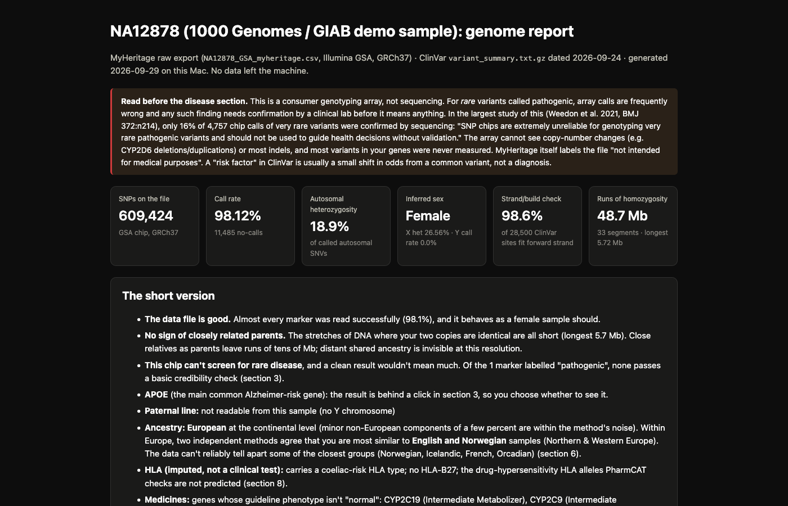
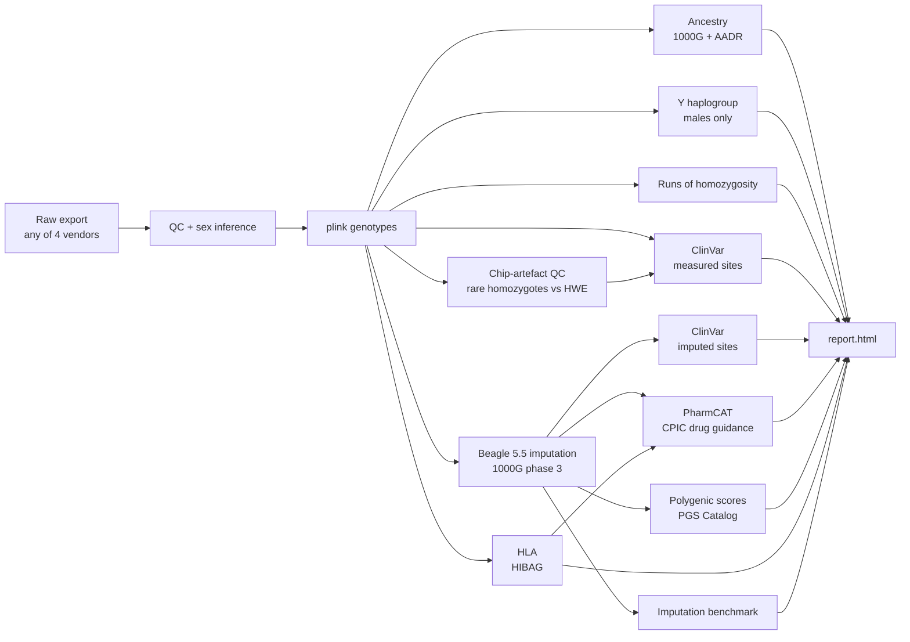

# genome-decoded

**Turn a consumer DNA download (MyHeritage, FTDNA, 23andMe, AncestryDNA) into a readable, honest report:
ancestry, paternal line, drug response, HLA type, polygenic scores and clinically catalogued variants,
each with the caveats a geneticist would attach.** One command, on a laptop or a SLURM cluster, and nothing
about your genome ever leaves your machine.

➡️ **[See the report for the public demo sample](https://alentrgovcevic.github.io/genome-decoded/)**
(NA12878, the 1000 Genomes / Genome in a Bottle reference sample, run exactly as you would run yourself).

[](https://alentrgovcevic.github.io/genome-decoded/)

> Not a medical test. A consumer array reads ~600,000 positions, and its calls for very rare variants are
> mostly wrong: 16% were confirmed by sequencing for variants rarer than 1 in 100,000 (Weedon et al. 2021,
> *BMJ* 372:n214). The report says so where it matters; confirm anything
> actionable with a clinical-grade test.

## What it does



| Step | What you get | Why it is done this way |
|---|---|---|
| **QC** | call rate, per-chromosome stats, inferred sex | Sex is inferred from X heterozygosity and Y call rate and passed to plink explicitly: plink's own `--23file` calls anyone with Y calls male, and female arrays carry noise calls on Y probes. |
| **Ancestry** | continental ADMIXTURE with bootstrap errors; a West-Eurasian PCA; membership probabilities per population | The PCA plots project you onto the reference axes. The membership probabilities don't: they come from a PCA with you *inside* the sample, because projection shrinks a new sample toward the centre. Only PCs above the Marchenko–Pastur noise edge are used. Every population label comes with its own leave-one-out accuracy, so you can see which labels the data can actually tell apart. Groups listed in `ancestry.pooled_groups` are merged; other weakly separable labels are shown with their low accuracy. |
| **Y haplogroup** | paternal lineage (23andMe's yhaplo) | Skipped automatically unless the sample is inferred male. |
| **Imputation** | ~48 M variants from ~600 k measured | Beagle 5.5 against 1000 Genomes phase 3, with the analysed person removed from the panel. Every imputed call carries its genotype probability; single-sample R² is meaningless, so the report uses per-genotype probability instead. |
| **Imputation benchmark** | accuracy by allele frequency and by confidence | The 503 unrelated 1000G Europeans (minus anyone excluded, so 502 for the demo) are cut down to the same chip positions and imputed the same way; their sequencing is the truth. |
| **Chip-artefact QC** | how many rare-allele homozygous calls are probe artefacts | Under Hardy–Weinberg the expected count of homozygotes for alleles below 1% is Σq²; the excess over that is the estimated number of artefacts. The flagged sites are marked in the measured ClinVar table and left out of the imputation used for polygenic scores. |
| **ClinVar** | measured and imputed variants with a ClinVar assertion, plus a fixed list of well-known markers (APOE, HFE, Factor V Leiden, prothrombin) | Measured hits are cross-checked against the artefact list. Imputed hits are shown only at genotype probability ≥ 0.99 and with pathogenic/likely-pathogenic or ≥ 2-star review status. |
| **Pharmacogenomics** | PharmCAT 3 report for 23 genes, with CPIC, DPWG and FDA-label guidance | PharmCAT expects sequencing-grade VCFs on GRCh38. The pipeline lifts over, rescues sites where the chip allele *is* the GRCh38 reference, keeps only imputed genotypes with probability ≥ 0.99, masks measured homozygous calls for alleles below 1% in 1000G (the typical probe artefact), handles G6PD by sex, and feeds the HLA-A and HLA-B calls in as outside calls. |
| **HLA** | HLA-A/B/C/DRB1/DQA1/DQB1/DPB1, 2-field | HIBAG with its pre-fit Illumina GSA European model, run on measured genotypes. |
| **Polygenic scores** | percentile vs the unrelated 1000G Europeans, with a bootstrap interval and per-population percentiles | The reference Europeans are imputed from the same chip sites as you, so both sides of the comparison carry the same imputation shrinkage (comparing imputed you to sequenced them biases the percentile). Scores are chosen by sex where the trait is sex-specific. |
| **Runs of homozygosity** | total length and longest segment | A quick read on parental relatedness; the report states the thresholds it uses. |

## Quick start

```bash
git clone https://github.com/alentrgovcevic/genome-decoded && cd genome-decoded
./install.sh              # conda envs into ./env (+ ./env-x86 on Apple Silicon) and HIBAG
./download_refs.sh        # ~9 GB of public reference data into ./reference; re-running skips what is there
env/bin/python demo/make_demo.py        # builds the demo input from 1000 Genomes
env/bin/snakemake -s workflow/Snakefile --cores 8
open runs/demo/results/report.html
```

Needs [Miniforge](https://github.com/conda-forge/miniforge) (or any conda/mamba). Disk, as measured: ~9 GB of
downloads grow to ~37 GB of reference once the shared panels are built (first run only), plus ~2 GB of software
(including PharmCAT's 0.9 GB reference FASTA, also counted in the downloads) and ~28 GB of intermediate files per person (`runs/<name>/data/`, safe to delete once the report exists). The demo
took about 90 minutes of compute on an Apple M4 Pro (14 cores, 24 GB RAM, `--cores 10`), not counting the one-off
panel build. That is the sum of three passes, because two bugs the demo exposed were fixed between them.

### Your own data

```bash
cp config/config.yaml config/local.yaml     # gitignored
# edit samples: →  me: {raw: /path/to/MyHeritage_raw_dna_data.csv, display_name: "Me"}
env/bin/snakemake -s workflow/Snakefile --configfile config/local.yaml --config 'run_samples=["me"]' --cores 8
```

The input format is detected from the file. Several people can be run side by side; each gets
`runs/<name>/`. If someone you analyse is *in* 1000 Genomes, add them to `exclude_from_reference`.

**Privacy by construction:** every download happens in `download_refs.sh`, before your file is read. No
step sends genotypes anywhere: no imputation server, no web API lookups by rsID. `runs/`, the genotype
formats the pipeline reads and writes, and `config/local.yaml` are gitignored.

### On an HPC cluster (SLURM)

```bash
./download_refs.sh                                    # on a login node: compute nodes need no internet
env/bin/snakemake -s workflow/Snakefile --profile profiles/slurm
# choose an account or partition:  --default-resources slurm_account=myproject slurm_partition=normal
```

The heavy rules declare their threads, memory and runtime; the rest take the profile's defaults. Per-chromosome
imputation fans out as separate jobs.

## Demo results (NA12878)

NA12878 is a good test because the right answers are known independently, and she is removed from every panel built
from 1000 Genomes before her own data are analysed. The AADR reference and HIBAG's pre-trained model are used as
published, so whether they include her was not checked. From [the demo report](https://alentrgovcevic.github.io/genome-decoded/):

| Check | Result | Known answer |
|---|---|---|
| Input | 609,424 GSA positions, 98.1% called | — |
| Sex inference | female (chrX heterozygosity 26.6%, chrY call rate 0%) | female |
| Continental ancestry (ADMIXTURE) | 99.997% European | CEU: Utah residents of Northern and Western European ancestry |
| Nearest 1000 Genomes population (502 Europeans) | CEU 60%, GBR 40% | CEU |
| Nearest AADR population (857 West Eurasians) | English (top LDA membership, and best mean allele-frequency likelihood; French wins more individual replicates) | — |
| HLA-A, -B, -C, -DRB1, -DQB1 (HIBAG) | A\*01:01/11:01, B\*08:01/56:01, C\*01:02/07:01, DRB1\*01:01/03:01, DQB1\*02:01/05:01 | **10 of 10 alleles match** the 1000 Genomes HLA typing (Abi-Rached et al. 2018, *PLoS One*, S2 Table) |
| Pharmacogenes (PharmCAT, imputed) | CYP2B6, CYP2C9, CYP2C19, CYP3A4, CYP3A5, CYP4F2, NAT2, SLCO1B1, TPMT, VKORC1 | Of the 12 genes both sources call, **10 match exactly** the CDC GeT-RM consensus genotypes (consolidated table, Jan 2025). The other two agree in part: UGT1A1 agrees on the single \*28 copy (GeT-RM \*60/\*28, PharmCAT \*1/\*80+\*28, different allele sets). DPYD agrees on \*4, and PharmCAT also lists c.1627A>G. CYP2D6 (GeT-RM \*3/\*68+\*4) is deliberately not called: arrays can't see copy number |
| Rare-allele homozygotes | 3 observed vs 0.5 expected | ≈ none: this input comes from sequencing, not a chip. The two real GSA exports this pipeline was developed on each showed an excess of about 1,400, which is the Weedon et al. effect |

**Imputation accuracy**, measured on the 502 other 1000G Europeans imputed from the same chip positions, with
their sequencing as truth. A 1-in-200 sample of imputed SNVs gave 200,935 sites. The table covers the 67,249 of them
that vary among the 502; frequency is the minor-allele frequency in those 502.

| Minor-allele frequency | Median dosage r² | Non-reference concordance |
|---|---|---|
| < 0.1% | 0.50 | 89.3% |
| 0.1–0.5% | 0.50 | 81.7% |
| 0.5–1% | 0.60 | 73.8% |
| 1–5% | 0.90 | 87.0% |
| 5–20% | 0.96 | 92.4% |
| 20–50% | 0.97 | 94.6% |

Genotypes imputed with probability ≥ 0.99 (97% of all imputed genotypes) are correct **99.87%** of the time, and
those below 0.8 only 64%. That is why every downstream step filters on genotype probability.

## Design notes and gotchas

- **One reference panel, many uses.** `exclude_from_reference` produces one derived 1000G panel; imputation,
  PCA, allele frequencies and PGS all read that one, so no analysed person is ever compared with themselves.
- **Apple Silicon.** plink2 and ADMIXTURE have no arm64 conda builds; `install.sh` puts them in an osx-64
  environment that runs under Rosetta 2. On Linux everything lives in one environment.
- **The chip is not a sequencer.** Rare homozygous calls are counted against Hardy–Weinberg expectation, flagged in
  the measured ClinVar table, masked for PharmCAT, and left out of the reference imputation.
- **Strand.** The pipeline assumes GRCh37 forward-strand genotypes, and the report measures this per file (the share
  of ClinVar-matched sites that fit the forward strand). PGS Catalog harmonised files are on the forward strand too,
  so strand-ambiguous SNPs are kept for scoring. AADR's Human Origins SNPs are checked against the chip alleles.
- **macOS bash 3.2** is supported (no associative arrays; empty-array expansion is guarded under `set -u`).

## Tests

```bash
env/bin/python -m pytest -q tests      # input parsing (MyHeritage/FTDNA layout, 23andMe, AncestryDNA), sex inference, config, statistics
```

CI (`.github/workflows/tests.yml`) runs the unit tests and parses every shell script and the workflow.
The full pipeline needs the ~37 GB reference, so it is exercised by the demo run, not in CI.

## Licences and credits

This repository's code is **MIT** (see `LICENSE`). The tools and data it installs and downloads keep their own
terms, which you accept when `install.sh` and `download_refs.sh` fetch them:

| Component | Licence / terms |
|---|---|
| plink 1.9, plink 2 | GPL / GPL-3 |
| bcftools / htslib | GPL / MIT |
| Beagle 5.5 | GPL-3.0-or-later |
| PharmCAT 3 | MPL-2.0; guidance from [CPIC](https://cpicpgx.org), DPWG and FDA labels, allele definitions via [ClinPGx](https://www.clinpgx.org) (formerly PharmGKB) |
| HIBAG | GPL-3 |
| CrossMap | GPL-3.0-or-later |
| ADMIXTURE 1.3 | **free for academic use** |
| yhaplo | **non-commercial research use** (23andMe licence). *The Yhaplo™ Software was developed by 23andMe, Inc.* |
| Snakemake, pysam | MIT |
| pandas, numpy, scipy / matplotlib | BSD-3-Clause / PSF-2.0 |
| 1000 Genomes phase 3 | publicly downloadable; fetched as the plink2 resource files ([cog-genomics.org/plink/2.0/resources](https://www.cog-genomics.org/plink/2.0/resources)) |
| AADR v66 (Mallick et al. 2024, *Sci Data* 11:182) | CC0 1.0 (Harvard Dataverse doi:10.7910/DVN/FFIDCW) |
| ClinVar | NCBI; see NCBI's [data use policy](https://www.ncbi.nlm.nih.gov/home/about/policies/) |
| PGS Catalog scores | cite the PGS Catalog (Lambert et al. 2021, *Nat Genet* 53:420) and each score's publication. **PGS000014 and PGS000016 are "freely available to the academic community for research use"; commercial use needs the authors' permission** |

Scores used by default: PGS000018 (coronary artery disease, Inouye 2018), PGS000014 (type 2 diabetes, Khera
2018), PGS000016 (atrial fibrillation, Khera 2018), PGS000074 (colorectal cancer, Graff 2021), PGS000662
(prostate cancer, Conti 2021, males), PGS000004 (breast cancer, Mavaddat 2018, females).

The demo individual NA12878 is a 1000 Genomes / Genome in a Bottle participant whose genotypes are publicly
downloadable (terms: the [IGSR data reuse statement](https://www.internationalgenome.org/data-portal/data-reuse)).
Its "MyHeritage export" is synthesised from 1000 Genomes genotypes at the positions of
the Illumina GSA chip (`demo/gsa_sites.tsv.gz`, a site list with no genotypes).
